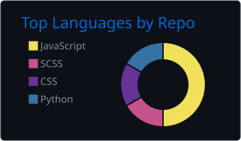

<!--
  DARK ANDR0XY // GitHub profile
  Two tracks: Cybersecurity × Software Development
-->

<p align="center">
  
</p>

<h1 align="center">DARK ANDR0XY</h1>
<p align="center">
  <code>@r3con-ng</code> &nbsp;|&nbsp; <code>CYBERSECURITY × SOFTWARE DEVELOPMENT</code>
</p>

<p align="center">
  
</p>

<p align="center">
  <a href="https://r3con-ng.modulify.website/"></a>
  <a href="https://linkedin.com/in/vaibhavpandey2006"></a>
  <a href="https://github.com/r3con-ng"></a>
  
</p>

---

### `00 // WHOAMI`

```bash
┌──(darkandr0xy㉿r3con-ng)-[~]
└─$ whoami
Dark Andr0xy

┌──(darkandr0xy㉿r3con-ng)-[~]
└─$ cat mission.txt
Explore systems. Build software. Understand security.
```

I'm working toward two connected goals: **Cybersecurity** and **Software Development**.

One side is about understanding systems, networks, and application security. The other is about designing, coding, and shipping useful software. I enjoy both because building technology and understanding how to secure it go hand in hand.

---

## `01 // CYBERSECURITY TRACK`

<text></text>
**RECON · ANALYZE · TEST · SECURE**

My security journey is focused on Linux, networking, ethical hacking concepts, web application security, and CTF-style problem solving. I prefer learning through hands-on practice in personal labs and authorized environments.

**Linux environment**
- Arch Linux as my primary Linux environment and exploring **BlackArch Linux** and its security-focused toolset.
- Terminal workflows, package management, system configuration, and troubleshooting.
- Exploring security utilities available across Linux environments.

**Security tools & learning areas**

<p>
  
  
  
  
  
</p>

- **OWASP ZAP** — web proxy, request inspection, and learning web application security testing.
- **BlackArch tools** — exploring the security utilities and workflows available in the distribution.
- **Nmap / Wireshark / Burp Suite** — tools on my exploration list for network discovery, traffic analysis, and web testing.
- **CTFs & labs** — learning methodology through controlled challenges and authorized practice.

**Networking foundations**

| Area | Concepts I'm building on |
|---|---|
| Network models | OSI model, TCP/IP |
| Addressing | IPv4, subnetting fundamentals |
| Protocols & ports | TCP, UDP, DNS, DHCP, HTTP/HTTPS |
| Network infrastructure | Routing, switching concepts, common services |
| Analysis | Packet flow, traffic inspection, connectivity troubleshooting |
| Web security | Requests, responses, cookies, sessions, proxies, common vulnerabilities |

**Cybersecurity objectives**
- Improve Linux and command-line proficiency.
- Build stronger networking and packet-analysis fundamentals.
- Practice web security testing with OWASP ZAP.
- Explore BlackArch utilities and understand when to use them.
- Solve CTF challenges and keep structured lab notes.
- Develop a responsible, ethical approach to security research.

---

## `02 // SOFTWARE DEVELOPMENT TRACK`

**DESIGN · CODE · DEBUG · BUILD**

I also enjoy creating practical applications and turning ideas into working prototypes. My current development foundation is front-end web development, while I continue strengthening core programming and software engineering concepts.

**Current development stack**

<p>
  
</p>

- **Frontend:** HTML, CSS, JavaScript.
- **Developer workflow:** Git, GitHub, VS Code, browser-based debugging.
- **Core foundations:** OOP, Data Structures & Algorithms, databases, and problem solving.

**What I'm growing into**
- **MERN Stack:** exploring MongoDB, Express.js, React, and Node.js to expand from frontend into full-stack development.
- **AI & emerging technologies:** learning how AI can be applied in useful software and real-world projects.
- **Software engineering:** writing cleaner code, structuring projects, debugging, and improving maintainability.

**Developer objectives**
- Strengthen JavaScript and programming fundamentals.
- Build more complete web applications.
- Progress toward full-stack development with the MERN ecosystem.
- Improve OOP, DSA, and database knowledge through practice.
- Explore practical AI integrations.
- Write maintainable code and use Git/GitHub effectively.

---

### `03 // PROJECTS & BUILDS`

| Project | Track | Description |
|---|---|---|
| [**Guide-Motion**](https://github.com/r3con-ng/Guide-Motion) | Software Development | A simulated railway companion prototype for exploring train journeys, station facilities, and passenger services. |
| [**KisanConnect**](https://github.com/r3con-ng/KisanConnect) | Software Development | A bilingual farmer-to-consumer marketplace prototype built around an Indian agriculture use case. |
| [**Diet-chart**](https://github.com/r3con-ng/Diet-chart) | Software Development | A browser-based diet chart builder with nutrition tracking and export features. |

### `04 // CURRENT STATUS`

```text
[ CYBERSECURITY ]  Linux / BlackArch / OWASP ZAP / Networking / CTF
[ DEVELOPMENT  ]  HTML / CSS / JavaScript / Git / Web Applications
[ EXPLORING    ]  MERN Stack / AI / Security Tooling / Packet Analysis
[ MINDSET      ]  Build responsibly. Test ethically. Keep learning.
```

### `05 // GITHUB TELEMETRY`

<p align="center">
  
  
</p>
<p align="center">
  
</p>

### `06 // CONNECT`

<p align="center">
  Interested in cybersecurity, software development, Linux, open source, CTFs, and building useful technology.
</p>
<p align="center">
  <a href="https://r3con-ng.modulify.website/">Portfolio</a> &nbsp; • &nbsp;
  <a href="https://linkedin.com/in/vaibhavpandey2006">LinkedIn</a> &nbsp; • &nbsp;
  <a href="https://github.com/r3con-ng">GitHub</a>
</p>

<p align="center">
  <code>[ CYBERSECURITY: ACTIVE ]</code> &nbsp; <code>[ DEVELOPMENT: ACTIVE ]</code> &nbsp; <code>[ LEARNING: ALWAYS ]</code>
</p>
<p align="center"><sub>UNDERSTAND • BUILD • TEST • SECURE</sub></p>
