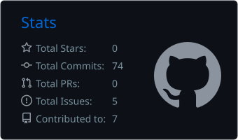
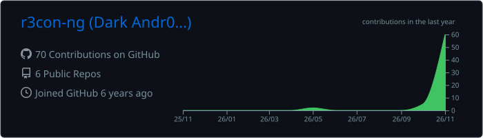

<!-- DARK ANDR0XY // interactive profile terminal -->

<div align="center">

  <h1>⟢ DARK ANDR0XY</h1>
  <p><code>root@r3con-ng:~$ ./initialize_profile.sh</code></p>
  <p><strong>CYBERSECURITY <code>×</code> SOFTWARE DEVELOPMENT</strong></p>

  <a href="https://r3con-ng.vercel.app/">
    
  </a>

  <p><code>r3con-ng.vercel.app</code></p>
  <p><sub>PROJECTS • EXPERIMENTS • SKILLS • CURRENT BUILDS</sub></p>

  <p>
    <a href="#whoami"></a>
    <a href="#cybersecurity"></a>
    <a href="#development"></a>
    <a href="#projects"></a>
    <a href="#telemetry"></a>
    <a href="#connect"></a>
  </p>

  

  <p>
    
  </p>

  <p>
    <a href="https://linkedin.com/in/vaibhavpandey2006"></a>
    <a href="https://github.com/r3con-ng"></a>
    
  </p>

</div>

---

## <a id="whoami"></a> `00 // WHOAMI`

```bash
┌──(darkandr0xy㉿r3con-ng)-[~]
└─$ whoami
DARK ANDR0XY

┌──(darkandr0xy㉿r3con-ng)-[~]
└─$ cat mission.txt
Explore systems. Build software. Understand security.
```

I'm working toward two connected goals: **Cybersecurity** and **Software Development**.

One side is about understanding systems, networks, and application security. The other is about designing, coding, and shipping useful software. I enjoy both because building technology and understanding how to secure it go hand in hand.

<details>
<summary><code>▶ ./show_current_focus.sh</code></summary>

- **Security:** Linux, networking, ethical hacking concepts, web application security, CTF-style learning.
- **Development:** frontend web development, JavaScript, software fundamentals, and practical prototypes.
- **Approach:** hands-on learning, responsible testing, and continuous improvement.

</details>

---

## <a id="cybersecurity"></a> <code>01 // CYBERSECURITY TRACK</code>

<p><code>[ RECON ] → [ ANALYZE ] → [ TEST ] → [ SECURE ]</code></p>

My security journey is focused on Linux, networking, ethical hacking concepts, web application security, and CTF-style problem solving. I practice in personal labs and authorized environments.

**ENVIRONMENT**

<p>
  
  
  
</p>

**TOOLS ON MY LEARNING RADAR**

<p>
  
  
  
  
</p>

<details>
<summary><code>＋ NETWORKING FOUNDATIONS</code></summary>

| DOMAIN | CONCEPTS |
|---|---|
| Network models | OSI model, TCP/IP |
| Addressing | IPv4, subnetting fundamentals |
| Protocols & ports | TCP, UDP, DNS, DHCP, HTTP/HTTPS |
| Infrastructure | Routing, switching concepts, common services |
| Analysis | Packet flow, traffic inspection, connectivity troubleshooting |
| Web security | Requests, responses, cookies, sessions, proxies, common vulnerabilities |

</details>

<details>
<summary><code>＋ SECURITY OBJECTIVES</code></summary>

- Improve Linux and command-line proficiency.
- Build stronger networking and packet-analysis fundamentals.
- Practice web security testing with OWASP ZAP.
- Explore BlackArch utilities and understand when to use them.
- Solve CTF challenges and maintain structured lab notes.
- Develop a responsible, ethical approach to security research.

</details>

---

## <a id="development"></a> <code>02 // SOFTWARE DEVELOPMENT TRACK</code>

<p><code>[ DESIGN ] → [ CODE ] → [ DEBUG ] → [ BUILD ]</code></p>

I enjoy creating practical applications and turning ideas into working prototypes. My current development foundation is front-end web development, while I continue strengthening core programming and software engineering concepts.

**CURRENT STACK**

<p>
  
</p>

| AREA | FOCUS |
|---|---|
| Frontend | HTML, CSS, JavaScript |
| Workflow | Git, GitHub, VS Code, browser debugging |
| Core foundations | OOP, DSA, databases, problem solving |
| Exploring next | MERN stack and practical AI integrations |

<details>
<summary><code>＋ DEVELOPMENT ROADMAP</code></summary>

- Strengthen JavaScript and programming fundamentals.
- Build more complete web applications.
- Progress toward full-stack development with the MERN ecosystem.
- Improve OOP, DSA, and database knowledge through practice.
- Explore practical AI integrations.
- Write maintainable code and use Git/GitHub effectively.

</details>

---

## <a id="projects"></a> <code>03 // PROJECTS & BUILDS</code>

<p><sub>SELECT A PROJECT TO OPEN ITS REPOSITORY</sub></p>

<table>
  <tr>
    <td width="50%" valign="top">
      <h3>01 / GUIDE-MOTION</h3>
      <p><code>RAILWAY COMPANION</code></p>
      A simulated railway companion prototype for exploring train journeys, station facilities, and passenger services.
      <p><a href="https://github.com/r3con-ng/Guide-Motion"></a></p>
    </td>
    <td width="50%" valign="top">
      <h3>02 / KISANCONNECT</h3>
      <p><code>AGRI MARKETPLACE</code></p>
      A bilingual farmer-to-consumer marketplace prototype built around an Indian agriculture use case.
      <p><a href="https://github.com/r3con-ng/KisanConnect"></a></p>
    </td>
  </tr>
  <tr>
    <td width="50%" valign="top">
      <h3>03 / DIET-CHART</h3>
      <p><code>NUTRITION PLANNER</code></p>
      A browser-based diet chart builder with nutrition tracking and export features.
      <p><a href="https://github.com/r3con-ng/Diet-chart"></a></p>
    </td>
    <td width="50%" valign="top">
      <h3>04 / MORE INCOMING</h3>
      <p><code>BUILD LOG: CONTINUOUS</code></p>
      New experiments, prototypes, and learning projects will appear here as they take shape.
      <p><a href="https://github.com/r3con-ng?tab=repositories"></a></p>
    </td>
  </tr>
</table>

---

## <a id="status"></a> <code>04 // SYSTEM STATUS</code>

```text
┌──────────────────────────────────────────────────────────────┐
│  DARK ANDR0XY // LEARNING MONITOR                             │
├──────────────────────────────────────────────────────────────┤
│  CYBERSECURITY   [ ACTIVE ]  Linux / Networking / Web Security│
│  DEVELOPMENT    [ ACTIVE ]  HTML / CSS / JavaScript / Git    │
│  EXPLORING      [ ONGOING ] MERN / AI / Packet Analysis       │
│  MINDSET        [ ONLINE ]  Build responsibly. Test ethically.│
└──────────────────────────────────────────────────────────────┘
```

---

## <a id="telemetry"></a> <code>05 // GITHUB TELEMETRY</code>

<p align="center">
  
  
</p>
<p align="center">
  
</p>

---

## <a id="connect"></a> <code>06 // ESTABLISH CONNECTION</code>

<div align="center">

<pre>
$ contact --initialize
[+] Looking for builders, learners and collaborators...
[+] Connection channels available.
</pre>

<a href="https://r3con-ng.vercel.app/">
  
</a>
<a href="https://linkedin.com/in/vaibhavpandey2006">
  
</a>
<a href="https://github.com/r3con-ng">
  
</a>

<p><code>[ CYBERSECURITY: ACTIVE ] [ DEVELOPMENT: ACTIVE ] [ LEARNING: ALWAYS ]</code></p>
<p><sub>UNDERSTAND • BUILD • TEST • SECURE</sub></p>

</div>
